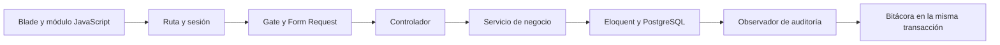

# Arquitectura y trazabilidad de la base del sistema

> Referencia vigente: [Adecuación del programa al Word V6](ADECUACION_WORD_V6_2026-11-07.md). Esta guía conserva etapas anteriores; sus preguntas, funciones retiradas y estados provisionales no prevalecen sobre la V6 definitiva.

> Actualización del 7 de noviembre: la referencia vigente es el [informe de avance V3](INFORME_AVANCE_V3_2026-11-07.md), contrastado con el nuevo Word. Incorpora varios turnos, protección presencial, reparto inicial 50/50 con enteros y alternancia, bloqueos y aperturas de Recepción, disponibilidad provisional, citas afectadas y consulta de auditoría. Los apartados siguientes conservan el estado anterior y deben leerse como antecedentes cuando difieran del informe V3.

La entrega contiene avances de los módulos 1 al 6, CU07 parcial y la infraestructura de CU22 en Laravel 13, Blade, JavaScript y PostgreSQL. La referencia funcional es `../Nuevo parcial angelica.docx`, revisada nuevamente el 4 de noviembre de 2026. Según la última actualización del equipo, **CU01–CU05 están establecidos y CU06–CU23 siguen en revisión**; las implementaciones de estos últimos son provisionales y están sujetas a ajustes. Este estado procede de la comunicación del equipo, sin implicar un nuevo contraste del Word. La implementación anterior de citas y reportes se conserva y permanece deshabilitada por defecto hasta integrar pagos y distribución de cupos.

La [revisión del Word del 4 de noviembre](REVISION_WORD_2026-11-04.md) distingue lo ya documentado, las ampliaciones de implementación y los apartados aún por sincronizar. Esa revisión reemplaza las conclusiones anteriores que indicaban que CU23 no estaba identificado o que CU01–CU02 no incluían al Paciente.

El [ajuste de implementación a CU01–CU05](AJUSTE_CU01_A_CU05_2026-11-04.md) cierra las diferencias detectadas en los casos establecidos: incorpora consultas de solo lectura, estados independientes, especialidades activas, normalización completa de espacios, identificación de citas afectadas y tratamiento de excepciones de login/logout. La validación actual consta de 53 pruebas Laravel, 540 aserciones y 6 pruebas JavaScript.

## Cómo defender la arquitectura

Se mantiene un monolito modular: una aplicación Laravel, una base de datos y responsabilidades separadas por módulo. Esto corresponde a la arquitectura cliente-servidor y por capas descrita en el documento, sin introducir servicios externos o capas que todavía no necesita el proyecto.

| Capa | Responsabilidad | Ubicación |
| --- | --- | --- |
| Presentación | Formularios, listados, mensajes, navegación según permisos | `resources/views`, `resources/js/modules`, `resources/css` |
| Entrada HTTP | Recibir solicitudes y devolver resultados; sin decidir el rol a partir del cliente | `routes/web.php`, `app/Http/Controllers` |
| Autorización y validación | Comprobar sesión, rol, campos y formatos | `ClinicSession`, Gates de `AppServiceProvider`, `app/Http/Requests` |
| Negocio | Aplicar reglas y coordinar transacciones y bloqueos | `app/Services/Catalog`, `Patients`, `Schedules` |
| Persistencia | Relaciones, restricciones únicas, claves foráneas e inmutabilidad | `app/Models`, `database/migrations` |
| Auditoría transversal | Registrar quién hizo qué, cuándo y sobre qué registro | `ClinicAuditObserver`, `AuditLogger`, `AuditEvent` |

El controlador deriva la validación a un Form Request y la operación a un servicio. El servicio utiliza Eloquent dentro de una transacción y los observadores registran los cambios en la misma conexión. PostgreSQL verifica las restricciones incluso cuando dos solicitudes compiten. No se agregan repositorios que solamente repitan los métodos de Eloquent.



## Correspondencia con el documento

Los paquetes P01, P02, P03, P04 y P08 se reflejan en los módulos siguientes. P07 se inicia únicamente con la cuenta del paciente; sus reservas y pagos permanecen pendientes.

| CU / paquete | Clases y archivos principales | Reglas aplicadas | Evidencia de prueba |
| --- | --- | --- | --- |
| CU01–CU02 / P01 | `AuthController`, `ClinicSession`, `ClinicAccess` | RN12; hash de contraseña, cuenta y perfil activos, sesión regenerada, cierre seguro, límite de intentos | `ClinicTest` y pruebas de autenticación/inactividad de `FoundationModulesTest` |
| CU03 / P01 | `Catalog/UserController`, `SaveUserRequest`, `CatalogService` | RN12; administración exclusiva del personal, médico vinculado único, impedir autodesactivación y conservar administrador activo | Pruebas de permisos y creación de usuarios de `ClinicTest` |
| CU04 / P02 | `Catalog/DoctorController`, `SaveDoctorRequest`, `Doctor` | RN02, RN04, RN11; matrícula única, varias especialidades, estados sin eliminar | Pruebas de catálogos de `ClinicTest`; auditoría de asignación de especialidades |
| CU05 / P02 | `Catalog/SpecialtyController`, `SaveSpecialtyRequest`, `Specialty` | RN02, RN11; nombre único sin distinguir mayúsculas, activación y desactivación | Pruebas de catálogos y auditoría |
| CU06 / P03 | `Catalog/PatientController`, `SavePatientRequest`, `Patient` | RN01, RN11, RN12; identificador interno, CI opcional y único, búsqueda y estados | Pruebas de duplicados, búsqueda y privacidad de `FoundationModulesTest` |
| CU23 identificado, detalle pendiente / P01 y P03 | `PatientRegistrationController`, `RegisterPatientRequest`, `Patients/RegisterPatient`, `PatientAccountInvitationController` | RF28, RN01, RN12, RN32; cuenta exclusiva de paciente, términos versionados y vínculo único; flujo de códigos pendiente de especificar | Pruebas de registro, términos, no elevación de privilegios, vinculación y rollback |
| CU07 parcial / P04 | `ScheduleController`, Requests de `Schedules`, `ScheduleService` | RN05, RN07, RN08, RN12, RN14; franjas válidas, duración configurable y conservación de citas previas | Pruebas de horarios e indisponibilidad de `ClinicTest` |
| CU22 infraestructura / P08 | `ClinicAuditObserver`, `AuditLogger`, `AuditEvent` y trigger PostgreSQL | RN59–RN62; eventos automáticos, metadatos, protección de secretos e inmutabilidad | Pruebas de contenido, rollback y rechazo de UPDATE, DELETE y TRUNCATE |

Los nombres de las clases no copian literalmente `ControlUsuarios` o `GestionPacientes` del análisis: en Laravel esas responsabilidades corresponden al servicio, controlador, formulario y vista del módulo. La separación conserva el sentido de frontera, control y entidad del documento.

## Matriz de acceso vigente

| Operación | Administrador | Recepcionista | Médico | Paciente |
| --- | --- | --- | --- | --- |
| Iniciar y cerrar sesión | Sí | Sí | Sí | Sí |
| Administrar cuentas del personal | Sí | No | No | No |
| Administrar médicos y especialidades | Sí | No | No | No |
| Administrar pacientes | No | Sí | No | No |
| Emitir código para vincular un paciente existente | No | Sí, con identidad verificada | No | No |
| Configurar horarios e indisponibilidades | Sí | No | No | No |
| Consultar perfil propio y cambiar contraseña | Sí | Sí | Sí | Sí |
| Modificar teléfono y dirección propios | No | No | No | Sí |
| Leer padrones de otros pacientes | No en el alcance base | Sí | No | No |
| Modificar o eliminar auditoría | No | No | No | No |

`ClinicAccess` entrega al frontend las vistas disponibles. Los Gates, Form Requests y middleware comprueban permisos en el servidor. Ocultar un botón no sustituye esa comprobación. La desactivación de un paciente o médico impide usar su cuenta vinculada aunque `users.status` siga activo.

## Registro y vinculación del paciente

Para una persona nueva, `POST /api/register` valida datos, confirmación de contraseña, aceptación y versión vigente de términos. El servicio crea el paciente y su cuenta en una transacción. El servidor fija `role=Paciente`, `status=Activo`, el vínculo `patient_id` y la fecha de aceptación; ignora cualquier rol, estado o vínculo suministrado por el visitante. Finalmente inicia una sesión regenerada. Si falla la cuenta, también se revierten el paciente y sus eventos de auditoría.

Para una persona ya registrada, recepción abre **CU06 → Vincular cuenta**, verifica presencialmente su identidad y genera un código de 48 caracteres válido por 48 horas. El código se muestra una sola vez; se persiste su SHA-256 y nunca se escribe en auditoría. Emitir otro código invalida el anterior. El paciente introduce el código y sus datos de identidad en el registro online, elige su contraseña y acepta los términos. El servicio bloquea paciente e invitación, comprueba vigencia, uso previo, estado y coincidencia de identidad, y vincula la cuenta al mismo paciente. No crea una segunda ficha de paciente ni modifica automáticamente sus datos clínico-administrativos.

Los códigos tienen un solo uso. La relación `users.patient_id` es única y una restricción exige que solamente las cuentas con rol Paciente tengan ese vínculo. Las cuentas médicas conservan su vínculo independiente `doctor_id`. Las cuentas de pacientes no se convierten en personal desde CU03.

No se envían correos ni códigos por servicios externos: recepción entrega el código al paciente verificado. El texto de condiciones identifica el entorno académico y la disponibilidad real de funciones; deberá ser aprobado por la clínica antes de usarlo en una implantación real. La verificación de correo y la recuperación de contraseña no forman parte de este alcance.

## Integridad y duplicados

El paciente siempre tiene una clave primaria interna; `PAC-001` es su representación en pantalla. El CI es opcional según RN01. Cuando existe, se normaliza a mayúsculas y PostgreSQL verifica su unicidad con `upper(trim(identity))`. Sin CI, una coincidencia exacta de nombres, apellidos, nacimiento y teléfono se rechaza para revisión de recepción; un índice parcial protege también ante altas simultáneas. Esta verificación no intenta determinar que personas con datos parecidos sean la misma ni fusiona registros.

Médicos, especialidades, pacientes y personal se activan o desactivan. No se exponen rutas de borrado. Las claves foráneas conservan las relaciones históricas. El perfil del paciente obtiene su registro exclusivamente desde la sesión y permite modificar solo teléfono y dirección; un `patient_id` enviado por el cliente no determina el registro afectado.

## Horarios básicos y compatibilidad

El alcance parcial conserva una franja por médico y día de la semana, con duración entre 5 y 240 minutos. Guardar el mismo día modifica esa franja; no crea turnos duplicados. La duración no puede superar el rango. Un bloqueo por médico serializa la configuración con las operaciones anteriores de citas. Las indisponibilidades conservan inicio, fin y motivo, y no cancelan citas automáticamente.

Si existen citas previas, un cambio que alteraría sus bloques se rechaza y la vista previa de indisponibilidad puede identificarlas. Se añadió de forma específica la [configuración de porcentajes y distribución por mayor resto](REGLA_CUPOS_MAYOR_RESTO.md), con desempate presencial. El soporte de varias franjas separadas en el mismo día y la asignación de horarios concretos a modalidades se deja para la ampliación de CU07. No se fija una duración comercial de consulta a partir de las reglas de pago.

La implementación anterior de CU08–CU17 permanece en sus archivos para facilitar la integración posterior. `CLINIC_APPOINTMENTS_ENABLED=false` es el valor por defecto: la API rechaza esas rutas y el menú no las ofrece. Las pruebas anteriores habilitan la opción únicamente dentro de sus casos de regresión. Activar la opción permite ejecutar el comportamiento anterior, que todavía no exige pago; no debe confundirse con la nueva solución de reservas ya terminada.

## Auditoría

Los eventos incluyen fecha/hora, usuario responsable cuando existe sesión, módulo, acción, tipo e identificador del registro, resultado y metadatos permitidos. Se auditan creación y modificación de personal, médicos, especialidades, pacientes, horarios e indisponibilidades; también login correcto o rechazado, logout, asignación de especialidades, autorización de vínculos y registro online. La operación de registro online queda atribuida explícitamente a la cuenta recién creada. Se conserva el observador sobre citas para la integración futura.

Los detalles de cambios guardan los nombres de campos afectados y no copias de datos personales. No se almacenan contraseñas, hashes de contraseñas, tokens, códigos de vinculación, cuerpos HTTP ni credenciales bancarias. Los cambios de relaciones médico/especialidad tienen un evento explícito porque `sync()` no dispara el observador del médico. Los cambios fallidos dentro de una transacción no dejan eventos de éxito.

El modelo rechaza modificar y borrar eventos; PostgreSQL también rechaza UPDATE, DELETE y TRUNCATE mediante un trigger. No hay endpoints de escritura ni consulta de auditoría en esta entrega; la pantalla de consulta de CU22 queda pendiente. El trigger protege frente a operaciones de aplicación, no frente a un propietario de base con capacidad de eliminar el trigger. Las escrituras SQL que eviten Eloquent no generan eventos automáticamente; deberán pasar por los servicios o registrar un evento explícito.

## Diferencias encontradas en el documento

1. CU01 y CU02 ya incluyen los cuatro roles. CU23 ya está identificado y respaldado por RF28, aunque su especificación detallada continúa pendiente. CU06 todavía conserva texto que niega las cuentas de pacientes y debe sincronizarse con el alcance ampliado.
2. RN01 permite CI opcional, mientras algunos pasos de CU06 parecen exigirlo. Se aplica la formulación de RN01: identificador interno siempre y CI único cuando se proporciona.
3. Las referencias anteriores de auditoría se actualizaron: RN60 y RN61 ya remiten a CU22. Esa discrepancia de la revisión anterior se considera corregida.
4. Las secciones de reservas, pago, reembolso y seguimiento deben conciliarse antes de habilitar citas. El código anterior no constituye evidencia de cumplimiento de las reglas nuevas RN39–RN58.

Estas decisiones documentan la implementación actual sin modificar el archivo Word original. La siguiente revisión académica debe actualizar actores, casos, secuencias y referencias de reglas para que describan el mismo alcance.

## Comprobación y demostración

```powershell
php artisan clinica:preparar-pruebas
php artisan test
node --check resources/js/app.js
node --check resources/js/modules/catalogs.js
node --check resources/js/modules/schedules.js
node --check resources/js/modules/patients.js
npm.cmd run build
php vendor/bin/pint --dirty --test
```

La base `clinica_vida_salud_test` se prepara con migraciones pendientes y las pruebas revierten sus transacciones. No se usa `migrate:fresh`, no se truncan datos del proyecto y no se vuelve a cargar la demostración.

Para la defensa: mostrar un acceso administrativo, crear una especialidad y un médico con varias especialidades, configurar un horario, acceder como recepción, registrar/buscar/desactivar pacientes y probar un registro online. Para demostrar conservación del identificador, emitir un código sobre un paciente existente y completar su registro. Mostrar que el paciente solo accede a su perfil y que solicitudes directas de catálogos se rechazan. Las pruebas de bitácora demuestran tanto el registro automático como la imposibilidad de alterar sus eventos.

No hubo un navegador conectado disponible durante esta revisión. Se verificaron pruebas HTTP de Laravel y compilación; queda pendiente la inspección visual manual en escritorio y móvil.

Resultado de validación del 3 de noviembre de 2026: **31 pruebas aprobadas, 310 aserciones**. Las tres migraciones nuevas se aplicaron tanto en la base local del proyecto como en la base aislada de pruebas. No se ejecutaron seeders sobre la base local.

El avance posterior basado en ideas seleccionadas del ZIP se documenta en [USO_DE_LA_GUIA_ZIP.md](USO_DE_LA_GUIA_ZIP.md): perfil para los cuatro roles, cambio de contraseña, revocación de sesiones y actualización de contacto que conserva modificaciones concurrentes de recepción. Su verificación amplía el resultado a **39 pruebas Laravel, 429 aserciones y 6 pruebas JavaScript**. No requiere nuevas migraciones ni añade módulos de pagos o reservas.
